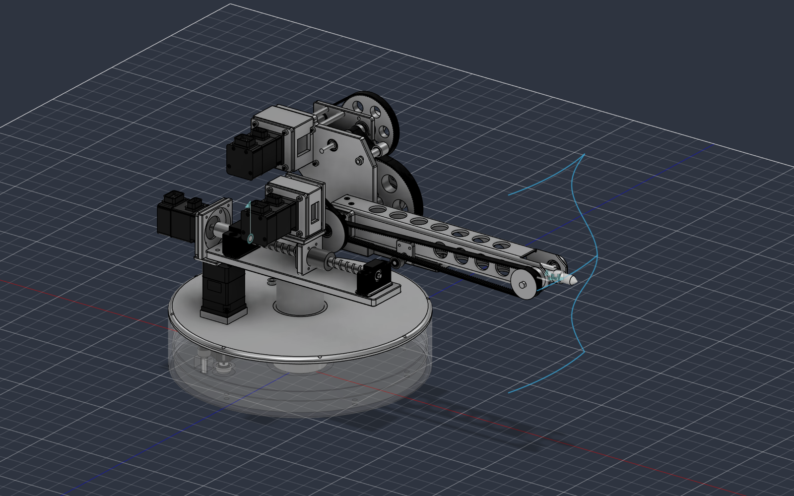

# R-P-R-R robot writing an E inside a wavy bucket: calculations and CAD model

Industrial Robotics 2026/27, Prof. Giberti, Project A, group E. State of 2026-11-26.

This folder holds everything that is currently in use for the robot part of the project: the calculations in MATLAB, the notes that explain them and say which lecture each method comes from, and the CAD model with its drawings. It covers the third (current) mechanical design only; the two earlier designs are not included.

> **What is in this repository.** The notes, the MATLAB code with the figures and console logs of its last run, and the scripts
> that were run inside Autodesk Fusion. **Not in this repository:** the CAD model (`E_Writing.f3d`), the STEP files, the drawing
> set, the video, and the `.mat` / `.slx` files that the MATLAB steps write when they run. Those are in the group's shared drive
> folder with the same name. Steps 1 to 5b and step 7 run from this repository as it is; step 7b also needs the six STEP files
> in `project/Fusion/v3/step7_bodies/`.

## Read in this order

1. This file: what the design is, where things are, how to run them, what is missing.
2. [docs/01_calculation_notes.md](docs/01_calculation_notes.md): each calculation step with its idea, its basis in the course, the procedure, the checks and the current numbers.
3. [docs/02_mechanical_design.md](docs/02_mechanical_design.md): the mechanism, the purchased parts and the catalogue checks, the joint limits, the checks made on the model, how to use the Fusion file.
4. The drawing set and its index (shared drive folder, `project/Fusion/v3/`).

## The design in one page

| Item | Value |
|---|---|
| Structure | q1 revolute about the vertical axis, q2 prismatic along a horizontal rail, q3 revolute (arm), q4 revolute (pen); fixed by the brief |
| Dimensions | q3 axis 225 mm above the floor; arm 300 mm; pen tip 50 mm from the q4 axis |
| Bucket | mean radius 390 mm, wave amplitude 17.55 mm, height 448.5 mm, 2.5 waves; the robot stands on its axis |
| Letter | E, 269 mm tall and 161 mm wide, on the inside of the wall, pen perpendicular to the wall |
| Motors | four Mitsubishi HG-KR053 (50 W) |
| Reductions | q1 1:50 (two belt stages); q2 ball screw with 10 mm lead; q3 1:42.19 (two belt stages); q4 1:6 (two belt stages, motor on the slider) |
| Joint limits from the CAD | q2 0 to 141 mm; q3 −42.6 to +45.6°; q4 ±132.6°; q1 free |
| Masses from the CAD | base 5.57 kg; column and rail 2.88 kg; slider 2.61 kg; arm 0.77 kg; pen head 0.07 kg |
| Cycle | Home, arc to the letter, the letter, straight line back to Home: 10.67 s |
| Kinematic quality along the letter | 1/κ from 0.29 to 0.34 |
| Motor use with 1 kg payload (RMS / rated, peak / maximum), Simscape with CAD bodies and drives | q1 0.21 / 0.20; q2 0.03 / 0.05; q3 0.54 / 0.30; q4 0.45 / 0.26; our limit is 0.8 |
| Shortest cycle that still passes the motor checks | 3.4 s with 0.2 kg, 4.8 s with 1 kg |



## What is in the folder

```
README.md                      this file
docs/
  01_calculation_notes.md      method, course basis, procedure, results
  02_mechanical_design.md      the mechanism and the checks on the model
  images/                      four views of the model
project/                       set this as the MATLAB current folder
  step*.m                      the calculation steps (run in order)
  RPRR*.m, traj_*.m, ...       functions used by the steps
  *.mat                        results of the last run (2026-11-26)
  robot_rprr.slx, robot_rprr_cad.slx   the two Simscape models (rebuilt on every run)
  figures/                     all plots of the last run
  logs/                        console output of the last run
  Fusion/
    E_Writing.mp4              the robot writing the E in the CAD model, with the unwrapped pen trace
    PlayWriting/               Fusion script that plays the writing cycle in the model
    joint_limits_fusion.py     places the robot in the model, finds collisions and joint limits
    step7_export_bodies.py, step7_pose_check.py   export of masses and shapes from Fusion for MATLAB
    render_video.py            makes the video from rendered frames
    v3/                        the third design
      E_Writing.f3d            the CAD model (Autodesk Fusion archive)
      step7_bodies/            STEP shape of each sub-assembly, mass_properties.json, pose_check.json
      E_Writing_1126_complete.pdf   all drawings, 123 sheets with bookmarks
      drawing_index.md         parts list: quantity, material, mass, page
      E_Writing_1126_drawings.pdf, _details.pdf, _exploded.pdf   the three exports the complete set is made of
      coupled_limits.png       usable slider travel inside the bucket against q3 and q4
      model_static.json, joint_limits_20261126.jsonl, trajectory_check.jsonl, play_check.json   results of the model checks
      *.py                     scripts that built and checked the model inside Fusion (a record; not needed to use the model)
```

### MATLAB files

| File | What it does |
|---|---|
| `step1_surface_E.m` | The surface and the letter wrapped onto it; pen direction at each point |
| `step2_size_robot.m` | Reach check of every letter point for our robot and, simplified, for the Epson C4; design map of shoulder height and rail angle |
| `step3_kinematics.m` | Tests of the kinematic functions; workspace; kinematic quality maps |
| `step3b_design_search.m` | Coarse search over the dimensions; where the current design ranks |
| `step4_trajectory.m` | The whole task in joint space, timed by the joint limits; three ways of handling corners; checks |
| `step5_dynamics.m` | Inverse dynamics along the trajectory; motor and reduction of each joint and their checks; payload and cycle time |
| `step5b_q3_options.m` | Three ways to drive q3 (50 W, 100 W, 50 W with a balancing spring) |
| `step7_simscape.m`, `build_rprr_simscape.m` | Simscape model with the same point masses as step 5; pen tip and joint loads compared |
| `step7b_simscape_cad.m`, `build_rprr_simscape_cad.m` | Simscape model with the CAD bodies and the drives; comparison with step 5 and explanation of the differences |
| `robot_params.m` | **Dimensions, joint limits, speed and acceleration limits: one place for all steps** |
| `robot_masses.m` | **Masses of the dynamic model**, computed from `Fusion/v3/step7_bodies/mass_properties.json` |
| `robot_coupled_limits.m`, `robot_limit_pose.m` | Slider travel that is free of the bucket for a given q3 and q4 |
| `motor_catalog.m`, `motor_use.m` | The six allowed motors; how much of a motor a joint uses over the cycle |
| `RPRRdir.m`, `RPRRinv.m`, `RPRRjac.m`, `RPRRjacP.m`, `RPRRscore.m` | Direct and inverse kinematics, Jacobian, its time derivative, quality score |
| `RPRRdyn.m`, `RPRRdirdin.m`, `RPRRjacdin.m`, `RPRRjacPdin.m` | Inverse dynamics and the extended kinematics of the point masses |
| `traj_min_time.m`, `traj_lines_parabolas.m`, `traj_cubic_spline.m` | Trajectory building blocks from the lectures |
| `wall_point.m` | A flat letter point to a point on the wall and the pen direction |

## How to run the calculations

MATLAB R2025a with Simscape Multibody was used. Set `project/` as the current folder and run:

```matlab
step1_surface_E
step2_size_robot
step3_kinematics
step3b_design_search
step4_trajectory
step5_dynamics
step5b_q3_options
step7_simscape
step7b_simscape_cad
```

The whole series takes a few minutes. Each script prints a summary, saves its figures in `figures/` and saves a `.mat` file that the later steps load. The printed output of the last run is in `logs/`; a new run should print the same numbers.

After a change, re-run from the step where the changed number lives: `step1_surface_E.m` (bucket and letter) → everything; `robot_params.m` → steps 2 onward; the settings at the top of `step4_trajectory.m` → steps 4 onward; the model in Fusion → export again with `Fusion/step7_export_bodies.py` and `Fusion/step7_pose_check.py`, then steps 5 onward.

To watch the Simscape model move, set `show = true` at the top of `step7b_simscape_cad.m` and run it from the MATLAB desktop (not with `matlab -batch`).

## How to look at the model

Open `project/Fusion/v3/E_Writing.f3d` in Autodesk Fusion (File, Open, Open from my computer). The four joints can be dragged; the ball screw, the pulleys and the shafts turn with them. Details are in `docs/02_mechanical_design.md`, section 7. Without Fusion, the STEP files in `step7_bodies/` open in any CAD program (one file per sub-assembly, without joints), and the video shows the motion.

## What has been verified

- The kinematic functions against numerical derivatives and round trips (errors of 1e-10 and below).
- The dynamic model against a hand calculation at rest and against the energy balance over the cycle.
- The MATLAB dynamic model against Simscape with the same point masses: joint loads equal to 1e-14 N·m.
- The Simscape model with CAD bodies against Fusion's own mass properties in three poses: 4.5e-10 relative.
- The trajectory inside the CAD model: 535 poses, no part of the robot touches another, only the pen touches the bucket wall.
- The motors: all four inside the 0.8 margin with 0.2 kg and with 1 kg, in MATLAB and in Simscape.

## What is not done

- **Step 8, the Epson C4 part of Project A**, has not been started. The assistant announced a separate task for it; check the course site.
- **The report and the presentation.**
- A video of the Simscape model was not recorded for this design.
- The mechanical design has open points that do not affect the calculations; they are listed in `docs/02_mechanical_design.md`, section 9.
- The limitations of the calculations are listed in `docs/01_calculation_notes.md`, section 12.

## Notes

- The code comments carry dated remarks such as "after CAD edition 1" or "DECIDED 2026-11-21". They record when something was introduced; the numbers in the notes above are the current ones.
- Everything here is in English with three exceptions that could not be changed: the headers of the parts lists on the drawing sheets (Fusion ran in Chinese; the columns are Item, Quantity, Part number, Material), a few internal names inside the Fusion file (some feature names and the names of appearances), and those same names where the Fusion scripts must refer to them, written there as `\u` escapes with the English meaning beside them.
- The Fusion scripts were written for one machine and one document name. They are included as a record of how the model was built and checked.
