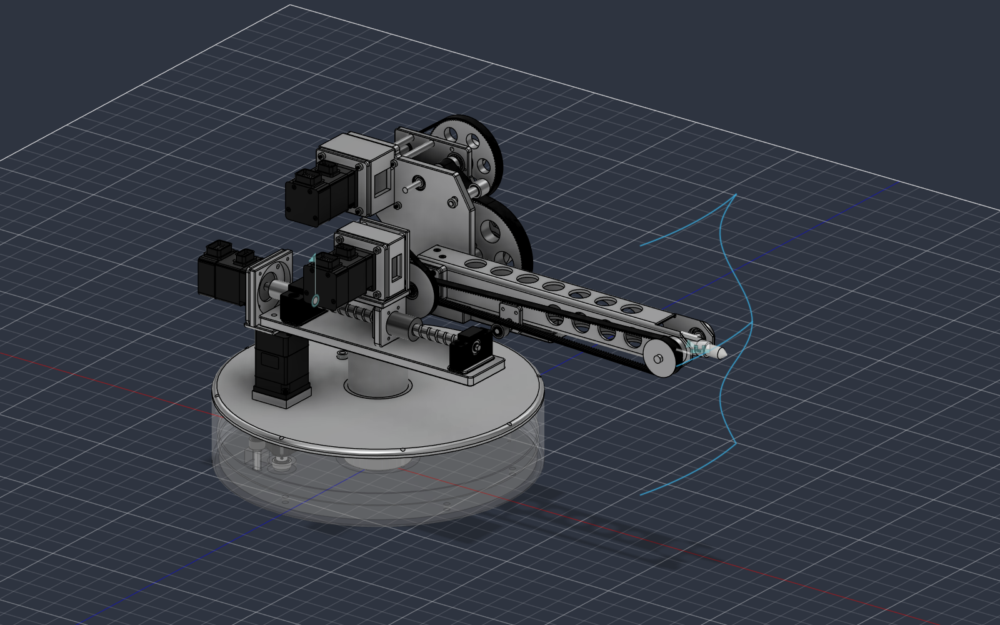
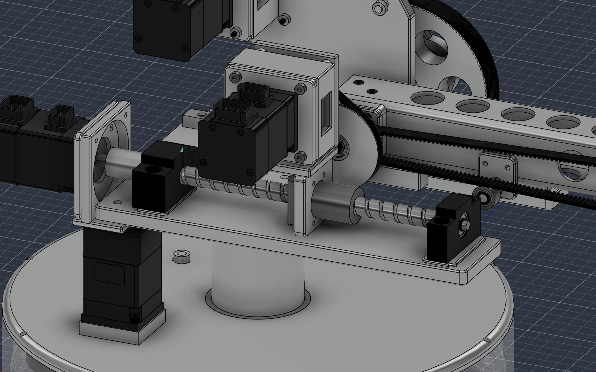
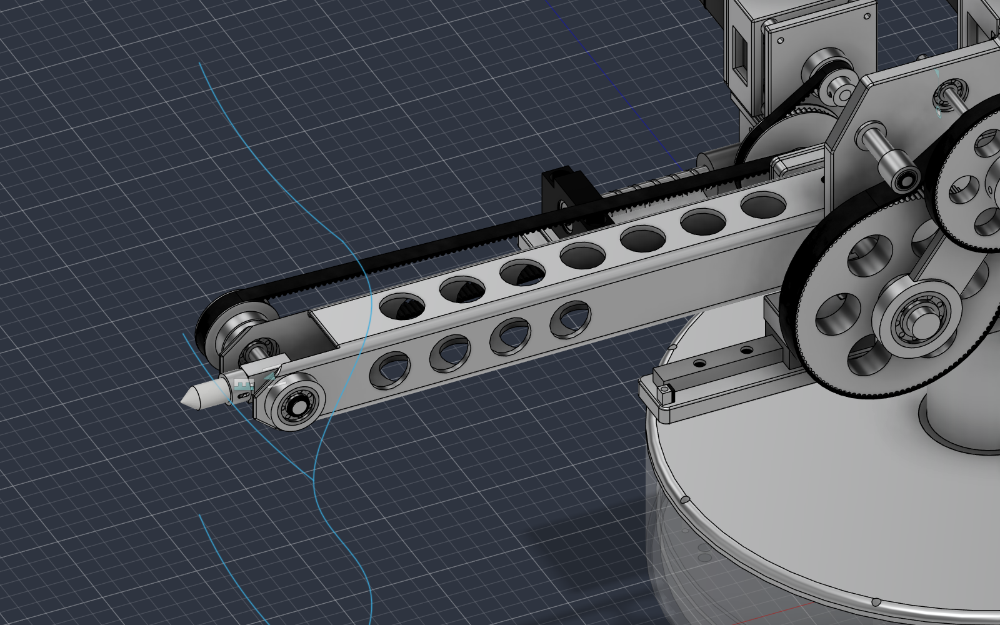
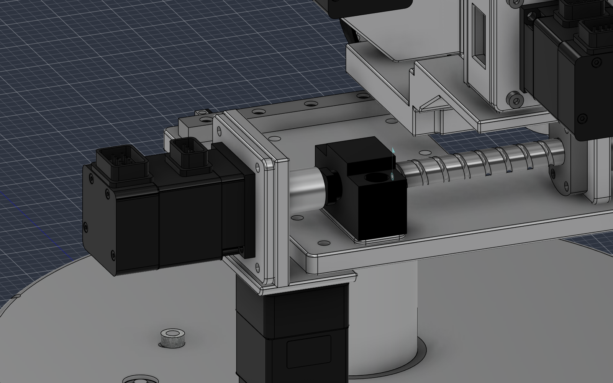

# Mechanical design: what the model contains and how it was checked

Third design of the R-P-R-R robot, state of 2026-11-26. The model is `project/Fusion/v3/E_Writing.f3d` (Autodesk Fusion). The drawings are in `project/Fusion/v3/E_Writing_1126_complete.pdf`, with the list of parts in `project/Fusion/v3/drawing_index.md`.

Every number below is marked by where it comes from: **model** = read or measured in the Fusion model, **catalogue** = read in a manufacturer's document, **calculated** = worked out by us, **estimate** = a reasonable value that was not verified.

## 1. Layout

The robot stands on the floor of the bucket, on the bucket's axis. Five rigid groups move against each other; they are the five sub-assemblies of the model.

| Group | Moves with | Contains | Mass (model) |
|---|---|---|---|
| D_01 Base | fixed | round base and lid (330 mm across), q1 motor, the two belt stages of q1, two bearings of the q1 spindle | 5.567 kg |
| D_02 Column and rail | q1 | spindle, column tube (50 mm outside, 2 mm wall), rail plate, guide rail, ball screw with its two supports, q2 motor | 2.877 kg |
| D_03 Slider | q2 | saddle on two guide blocks, two side plates carrying the q3 shaft, q3 motor with its two belt stages, q4 motor with its first belt stage and the double pulley on the q3 axis | 2.612 kg |
| D_04 Arm | q3 | square tube 40 × 40 × 3 mm, q3 shaft (15 mm), q3 output pulley, long q4 belt with its idler | 0.772 kg |
| D_05 Pen head | q4 | wrist shaft (8 mm), 40-tooth pulley, pen carrier, spring-loaded pen | 0.067 kg |

Total 11.9 kg, of which 6.3 kg moves (model). Fixed geometry: q3 axis 225 mm above the floor, rail horizontal, 300 mm from the q3 axis to the q4 axis, pen tip 50.0 mm from the q4 axis.

Frames used in the model and in every script: Y up; q1 about +Y; the slider frame has its origin on the q3 axis, x along the rail, y up, z sideways.

## 2. Drives

All four joints use the same motor, Mitsubishi HG-KR053 (50 W, rated 0.16 N·m, maximum 0.56 N·m, 0.34 kg; catalogue). The brief allows no commercial gearbox, so every reduction is made of timing-belt stages or a ball screw. All belts are 3 mm pitch GT belts (Gates 3MGT). No motor carries a belt directly: each motor drives, through a coupling (NBK XGT2-19C, 8 mm to 6 mm), a shaft that has its own two bearings.

| Joint | Motor sits on | Stage 1 | Stage 2 | Ratio |
|---|---|---|---|---|
| q1 | the base, shaft vertical | 18 → 120 teeth, belt 9 mm wide, 138 teeth | 16 → 120 teeth, belt 15 mm wide, 143 teeth; the 120-tooth pulley is bolted to the spindle | 1:50 |
| q2 | the rail plate | ball screw, 12 mm diameter, 10 mm lead | | 10 mm per motor turn |
| q3 | the slider | 16 → 90 teeth, belt 9 mm wide, 101 teeth (303 mm) | 16 → 120 teeth, belt 15 mm wide, 138 teeth (414 mm); the 120-tooth pulley is on the q3 shaft | 1:42.19 |
| q4 | the slider | 20 → 60 teeth, belt 6 mm wide | 20 → 40 teeth, belt 9 mm wide, 690 mm long, running along the arm to the wrist | 1:6 |

**Coupling between q3 and q4.** The 60-tooth and 20-tooth pulleys of q4 are one double pulley that idles on a fixed stub on the q3 axis (on two bearings, 686 and 626). Because the long belt rides on the arm, turning the arm also turns the wrist drive: the q4 motor turns by 6·q4 + 3·q3. The consequences for timing and motor torque are in `01_calculation_notes.md`, section 9. This layout was chosen to take the q4 motor (0.34 kg plus its bracket) off the arm, which is what allowed the 50 W motor on q3.

**Belt tension.** Each belt except q4's first stage has one smooth idler on its back, on an axle that can be moved in a slot. q4's first stage is tensioned by moving the motor bracket in its slots. For the two q3 belts the idler positions were solved so that the belt length is a whole number of teeth (`project/Fusion/v3/belt_path.py`); the Gates manual advises against fixed centres without adjustment (p.68–69).

**How the belts are drawn.** The teeth are drawn only on the free spans; where a belt wraps a pulley its inside is smooth and lies 0.02 mm outside the pulley's tooth tips. This lets the pulleys turn in the model without cutting into the belts.

## 3. Purchased parts and what was checked in catalogues

| Part | Fact used | Source |
|---|---|---|
| Timing pulleys, 3 mm pitch | Stock tooth counts include 16, 18, 20, 40, 60, 90, 120 (there is no 96). Largest stock bore: 6.35 mm for 16 teeth, 25.4 mm for 60 to 120 teeth. Pulleys of 60 teeth and more have no flanges | Gates *Light Power and Precision Drive Design Manual*, pulley tables p.31–33 |
| Belt rating | Rated torque by the small pulley, times a width factor (1.64 for 9 mm, 3.03 for 15 mm), reduced when fewer than 6 teeth are in mesh (× 0.8 for 5, × 0.6 for 4) | same manual, p.19 and p.104 |
| Belt length tolerance | ± 0.25 mm on the centre distance for belts of 381 to 508 mm, ± 0.30 mm for 508 to 762 mm | same manual, p.74 |
| Ball-screw supports EK08 (fixed) and EF08 (supported) | Width 52, height 32, bore centre 17 above the mounting face, raised block 25 wide, wings 26 high, two 6.6 mm holes at 38 mm pitch with 11 × 12 mm counterbores; length 23 (EK08) and 14 (EF08); EK08 0.24 kg, EF08 0.13 kg with its 606ZZ bearing | THK general catalogue, pages A15-330 and A15-316 |
| Ball-screw shaft end | Shape H1 for EK8: 8 mm journal with an M8×1 thread on its last 10 mm, 35 mm in all, then a 6 mm × 9 mm drive end; the screw shoulder stands 3.5 mm in front of the support | THK general catalogue, pages A15-322/323 |
| Lock nut | RN 8: M8×1, 17 mm round with 14 mm flats, 6.5 mm wide | THK general catalogue, page A15-353. The catalogue does not say in words that EK08 uses RN 8; it was matched by thread, flats and set screw |
| Motor | HG-KR053 data, see above | Mitsubishi *Servo Motor Instruction Manual (Vol. 3)*, chapter 6 |
| Guide | MGN12 rail (258 mm) with two MGN12H blocks; counterbores 6 × 4.5 mm for M3 screws | counterbore size from memory of the HIWIN catalogue, not re-checked |

Results of the catalogue checks:

- **16-tooth pulleys need a 6 mm shaft.** The intermediate shafts of q1 and q3 are therefore stepped: 6 mm under the 16-tooth pulley, 8 mm elsewhere.
- **q3 belts (calculated with the rating tables).** Stage 2: 16-tooth pulley with 5 teeth in mesh, rating about 4.7 N·m; peak load about 1.0 N·m, 2.0 N·m with a service factor of 2: margin about 2.4. Stage 1: 4 teeth in mesh, rating about 1.3 N·m; load with the same factor 0.32 N·m: margin about 4. The q1 and q4 belts were checked the same way in the earlier design, with margins above 3.
- **Two pulleys are not stock items**: q1's output pulley (120 teeth on a 40 mm spindle; a stock pulley has a 25.4 mm bore at most, so it is a reworked pulley bolted to a carrier on the spindle) and the 60/20-tooth double pulley of q4.
- **Guide (estimate).** The weight of slider and arm is offset from the single rail and tips it with about 2 N·m. The rated static moment of an MGN12H block is remembered as 36 to 38 N·m; this was not looked up again.

## 4. Structure and details

- **Base.** Round, 330 mm across, with a lid; rounded rims. It holds the q1 motor upright beside the column. At 5.6 kg it is heavier than it needs to be; it does not load any motor.
- **Column.** Round tube with a rectangular flange carrying the 10 mm rail plate.
- **Slider.** A saddle on the two guide blocks; two 9 mm side plates ("cheeks") carry the q3 shaft on three 6002 bearings (two in the cheeks, one in an outboard bridge beside the output pulley). The q3 and q4 motors each sit on a U-shaped support.
- **Arm.** Square tube with its four long edges rounded (5 mm outside, 2 mm inside), 22 lightening holes of 22 mm (7 in the top, 7 in the bottom, 4 in each side, at 32 mm pitch, the side holes offset by half a pitch), a fork at the tip with two bushes holding the 608 bearings of the wrist shaft, and the tip cut at an angle above and below. The holes take 68 g off the tube (352 g → 284 g, model). The cross-section at a hole keeps about half of its second moment of area (10.2 → 5.1 cm⁴, calculated), which gives about 0.025 mm of tip deflection under 1 kg (calculated as a cantilever, no finite-element analysis).
- **Pen head.** The pen slides in its carrier against a return spring, with 3 mm of travel, so that it can follow the wall between the via points of the trajectory.
- **Shafts.** Stepped, with flats for the set screws. Pulleys have hubs with set screws. Idler rollers run on two MR126 bearings (6 × 12 × 4) and are held on their axles by retaining rings.
- **Ball screw.** The thread is drawn as a right-hand helical groove of 10 mm lead (the groove radius 1.25 mm and depth 1.1 mm are illustrative, not catalogue values). The fixed end follows the THK shaft-end shape and carries the lock nut; the M8×1 thread itself is not drawn.
- **Fasteners drawn.** Rail screws (10 × M3), support screws (4 × M6), long screws and nuts of the motor supports, set screws, retaining rings. Not drawn: the screws between cheeks and saddle, between column and rail plate, of the nut bracket, between guide blocks and saddle, and of the q2 and q4 motors.
- **Materials as modelled.** Plates, tube, pulleys, base: aluminium 6061-T6. Shafts: aluminium 7075-T6. Bearings, screw, rail, fasteners: steel. Belts: rubber composite with an estimated density. Purchased parts with a catalogue mass (motors, couplings, supports, rail) carry a density chosen so that the drawn shape has the catalogue mass. Each part has the appearance of its material.

## 5. Joint limits

Each joint was moved alone in the model, from the reference pose (q1 0°, q2 80 mm, q3 0°, q4 0°), until two parts touch (`project/Fusion/joint_limits_fusion.py`, results in `project/Fusion/v3/joint_limits_20261126.jsonl`).

| Joint | Limit in the model | What stops it | Range used for planning | Range used by the task |
|---|---|---|---|---|
| q1 | none within ±180° | (cables are not modelled) | ±180° | −11.9 to 11.9° |
| q2 | 0 to 141.0 mm | upper end: the front buffer meets a guide block | 0 to 141 mm | 1.9 to 94.6 mm |
| q3 | −42.56 to +45.56° | two stop pins on the drive cheek meet the q3 shaft | −42 to +45° | −32.6 to 32.6° |
| q4 | −132.56 to +132.56° | the pen meets the arm tube | ±131° | −81.0 to 64.1° |

Inside the bucket the usable q2 also depends on q3 and q4 (the arm tip, the wrist pulley and the pen carrier against the wavy wall; the lowered tube against the deck). That bound is the function `project/robot_coupled_limits.m`, drawn in `project/Fusion/v3/coupled_limits.png`.

## 6. Checks made on the model

All run on 2026-11-26 on the final model; result files are in `project/Fusion/v3/`.

| Check | Result | File |
|---|---|---|
| Timeline of the model | 1452 items, no error or warning | `model_static.json` |
| Interference at the reference pose | none | `model_static.json` |
| Every part touches another part | 213 instances; only the pen's return spring does not (its ends are helix ends) | `model_static.json` |
| Writing trajectory against the robot itself | 535 poses (every 10th sample), no interference | `trajectory_check.jsonl` |
| Writing trajectory against the bucket | only the pen touches the wall (297 poses, while writing); base and one tensioner part rest on the floor | `trajectory_check.jsonl` |
| Joint limits | table above | `joint_limits_20261126.jsonl` |
| Playback of the whole cycle | 10.67 s, pen tip equal to the direct kinematics (difference 2e-13 mm); turning parts at the angles given by the gear ratios at 25 sampled times | `play_check.json` |
| Mass properties against Simscape | three poses, relative difference 4.5e-10 | `project/logs/matlab_steps_5_to_7b.log` |

Three things to know about Fusion's interference analysis, found during these checks and handled in `joint_limits_fusion.py`: an overlap that is too thin has no volume and raised an error (it is now counted as a hit); at one pose (q1 = 56°) the analysis of the whole robot returned nothing, while every pair of sub-assemblies analysed separately showed no interference (the script then moves the pose by 0.01°); at q1 = 168° it reported an overlap between two parts that are fixed to each other and whose relative position was unchanged to 5e-15, which is a false report.

Not checked: strength and deflection of plates, shafts and standoffs (except the estimate for the arm above); tolerances and fits; poses that combine several joints outside the task and outside the single-joint sweeps.

## 7. Working with the Fusion file

- **Open.** In Fusion: File, Open, Open from my computer, choose `E_Writing.f3d`. The helper scripts in `project/Fusion/v3/` refuse to run unless the document is named `E_Writing_q3_50W_build`; save the opened document under that name if you want to run them.
- **Joints.** Four joints at the top level, `q1_Base_yaw`, `q2_Radial_slide`, `q3_Shoulder_pitch`, `q4_Wrist_pitch`. Drag a group or use Drive Joints.
- **Parts that turn with the joints.** The ball screw turns once per 10 mm of q2. The input and intermediate shafts with their pulleys turn by 50·q1 and 7.5·q1 (q1 drive), 42.19·q3 and 7.5·q3 (q3 drive), 3·q3 + 6·q4 and q3 + 2·q4 (q4 input and the double pulley). This is done with revolute joints, rigid groups and motion links. The belts do not move: a belt running round its pulleys is not a rigid motion and Fusion joints cannot show it.
- **Playback.** `project/Fusion/PlayWriting/` is a Fusion script (Utilities, Scripts and Add-Ins, add the folder, run). It plays the writing cycle stored in the model and checks the pen tip against the direct kinematics in every frame. `project/Fusion/E_Writing.mp4` is a recording of it with the unwrapped pen trace beside it.
- **The bucket** is the component `Wave_Drum`; its visibility is switched with its eye in the browser.
- **For scripts that place the robot directly** (`transformOccurrences`): parts that are free inside a sub-assembly do not follow it, and they end up displaced if the sub-assembly and its free parts are moved in one call from a saved state. `joint_limits_fusion.py` and `PlayWriting.py` therefore place the four groups first and all parts in a second call, using the table stored in the model (attribute `RPRR` / `SpinningParts`).
- **Scripts in `project/Fusion/v3/`.** They are the record of how the model was changed (`edition3.py` and its helpers for the third design; `q3_50w.py` for the 50 W q3 drive; `struct_fix*.py` for the review rounds; `publish_1126.py` and `package_drawings.py` for the drawings) and how it was checked (`model_checks.py`, `trajectory_verify.py`, `play_check.py`). They run inside Fusion and are not needed to use the model.

## 8. Drawings

`E_Writing_1126_complete.pdf`: 123 sheets with one bookmark per sheet. 100 sheets come from Fusion's automatic drawing of the assembly (assembly, five sub-assemblies, 88 kinds of parts, with automatic dimensions), 21 sheets are parts that the automatic drawing skips because their names look like fasteners (screws, nuts, and also the ball screw and its nut), and 2 sheets are the exploded view. All 109 kinds of parts have a sheet. `drawing_index.md` lists quantity, material, mass and page of every part.

Limits of these drawings: no tolerances or fits; the part number and material columns of the parts lists on the sheets are empty (the index has them); the headers of those lists are in Chinese because Fusion ran in Chinese (Item, Quantity, Part number, Material). Only two sheets were looked at one by one (assembly and arm tube).

## 9. Open points of the mechanical design

None of these changes the results of the calculations.

- Remaining screws are not drawn (list in section 4).
- The three 6002 bearings of the q3 shaft and the two 608 bearings in the fork have no axial retention.
- The base could be lighter.
- A few edges of the q3 motor support are still sharp.
- The idler of q3's second stage stands on a 34 mm cantilevered axle (about 18 MPa of bending stress, calculated).
- Two belts differ from their exact path length by 0.21 mm (q1 stage 2) and 0.30 mm (long q4 belt), which is inside the belt length tolerance and taken up by the idlers.
- Cables, sensors and limit switches are not part of the model.

